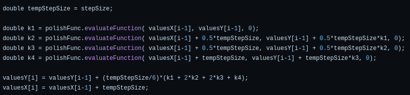
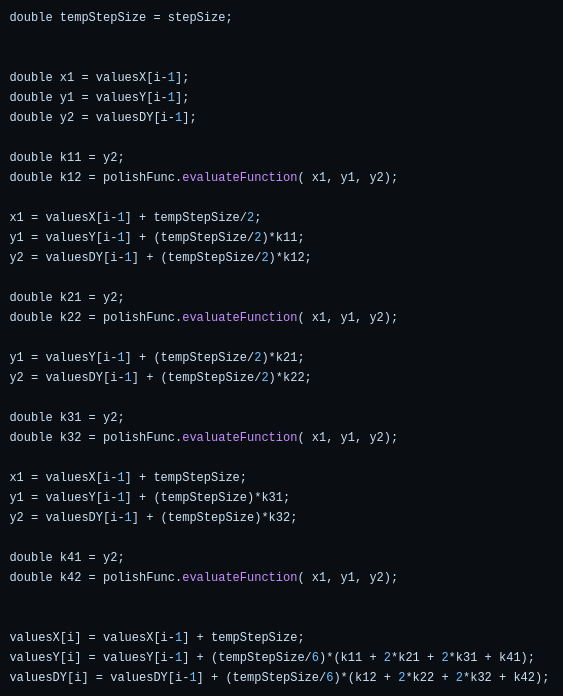

# Runge-Kutta method

Graphwar computes the curve by using the 4th order Runge-Kutta method in both ODE modes because any $m$-order explicit ODE is equivalent to a first-order ODE system, as follows:

$$
\frac{d^my}{dx^m}=f(x,y,\frac{dy}{dx},\frac{d^2y}{dx^2},\cdots,\frac{d^{m-1}y}{dx^{m-1}})
$$

is equivalent to

$$
\begin{cases}
\frac{dy_1}{dx}=y_2\\
\frac{dy_2}{dx}=y_3\\
\vdots\\
\frac{dy_{m-1}}{dx}=y_m\\
\frac{dy_m}{dx}=f(x,y_1,y_2,\cdots,y_m)\\
\end{cases}
$$

So generally consider the m-variable first-order ODE system IVP:

$$
\begin{cases}
\frac{d\mathbf y}{dx} = \mathbf f\bigl(x, \mathbf y(x)\bigr)\\
\mathbf y(x_0) = \mathbf y_{0}
\end{cases}
\qquad (1)
$$

where $\mathbf y\in\mathbb R^m,\mathbf f:\mathbb R\times\mathbb R^{m}\to\mathbb R^{m}$.

Let

$$
\begin{aligned}
\mathbf Y(x)
&=
\begin{pmatrix}
Y_0(x)\\
Y_1(x)\\
\vdots\\
Y_m(x)
\end{pmatrix}
{:}=
\begin{pmatrix}
x\\
\mathbf y(x)
\end{pmatrix},
\\
\mathbf F(\mathbf Y)
&=
\begin{pmatrix}
F_0(\mathbf Y)\\
F_1(\mathbf Y)\\
\vdots\\
F_m(\mathbf Y)
\end{pmatrix}
{:}=
\begin{pmatrix}
1\\
\mathbf f(x, \mathbf y)
\end{pmatrix}.
\end{aligned}
\qquad (2)
$$

Then $(1)$ is equivalent to the following self-consistent system:

$$
\begin{cases}
\frac{d\mathbf Y}{dx} = \mathbf F(\mathbf Y)\\
\mathbf Y_0=\mathbf Y(x_0)
\end{cases}
\qquad (3)
$$

Let $h$ be the step size, then the 4th order Runge-Kutta recursive formula is:

$$
\boxed{
\begin{aligned}
&\mathbf{K}_1 = \mathbf{F}(\mathbf{Y}_n),\\
&\mathbf{K}_2 = \mathbf{F}\left(\mathbf{Y}_n + \frac{h}{2}\mathbf{K}_1\right),\\
&\mathbf{K}_3 = \mathbf{F}\left(\mathbf{Y}_n + \frac{h}{2}\mathbf{K}_2\right),\\
&\mathbf{K}_4 = \mathbf{F}\left(\mathbf{Y}_n + h\mathbf{K}_3\right),\\
\hline
&\mathbf{Y}_{n+1} = \mathbf{Y}_n + \frac{h}{6}\Bigl(\mathbf{K}_1 + 2\mathbf{K}_2 + 2\mathbf{K}_3 + \mathbf{K}_4\Bigr).\\
\end{aligned}
} \qquad (4)
$$

Compute $\mathbf{Y}_0,\cdots,\mathbf{Y}_n$ using the recursive formula $(4)$, then you get $\{\mathbf{Y}_0,\mathbf{Y}_1,\cdots,\mathbf{Y}_n\}$: the point set of the graph of $(1)$ in $[x_0,x_0+nh]$, with an $O(h^4)$ global error (the local error is $O(h^5)$).

Particularly, in `y'` mode, we have

$$
\mathbf Y=\begin{pmatrix}x\\ y\end{pmatrix},\mathbf F=\begin{pmatrix}1\\ E\end{pmatrix},
$$

and in `y''` mode, we have

$$
\mathbf Y=\begin{pmatrix}x\\ y\\ y'\end{pmatrix},\mathbf F=\begin{pmatrix}1\\ y'\\ E\end{pmatrix}.
$$

The specific implementation of the algorithm of the game (Graphwar I) as follows:

